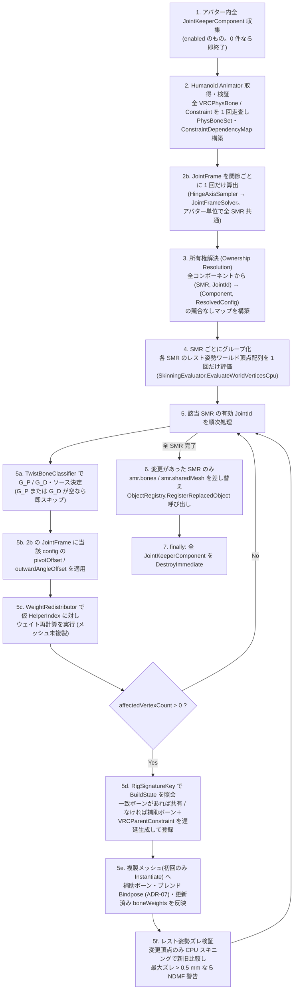

# ARCHITECTURE — JointKeeper

この文書は NDMF ベースの非破壊関節ボリューム維持ツール **JointKeeper** の詳細実装設計書です。
[overview.md](./overview.md) で定義された要件および確定済み設計方針に基づき、アセンブリ構成、データモデル、NDMF パイプライン、各コアモジュールのインターフェースと数理アルゴリズム、不変条件、テスト戦略を規定します。

---

## 目次

1. [高レベル設計と契約](#1-高レベル設計と契約)
2. [ディレクトリ・アセンブリ構成](#2-ディレクトリ・アセンブリ構成)
3. [ランタイムデータモデル設計](#3-ランタイムデータモデル設計)
4. [NDMF パイプライン設計](#4-ndmf-パイプライン設計)
5. [コアモジュール詳細仕様](#5-コアモジュール詳細仕様)
   - [5.1 TwistBoneClassifier（近位・遠位ボーン群分類）](#51-twistboneclassifier近位・遠位ボーン群分類)
   - [5.2 JointFrameSolver（関節ローカルフレーム構築）](#52-jointframesolver関節ローカルフレーム構築)
   - [5.3 SkinningEvaluator（頂点座標・Bindpose 厳密算出）](#53-skinningevaluator頂点座標・bindpose-厳密算出)
   - [5.4 VrcConstraintRigBuilder（VRCParentConstraint 統一ビルダー）](#54-vrcconstraintrigbuilder-vrcparentconstraint-統一ビルダー)
   - [5.5 WeightRedistributor（角モーメント保存＋4ボーン統合）](#55-weightredistributor角モーメント保存4ボーン統合)
6. [不変条件（Invariants）](#6-不変条件invariants)
7. [Editor UI・Phase 2 プレビュー設計](#7-editor-ui・phase-2-プレビュー設計)
8. [エッジケース対応マトリクス](#8-エッジケース対応マトリクス)
9. [テスト戦略と実装ロードマップ](#9-テスト戦略と実装ロードマップ)
10. [改訂履歴](#10-改訂履歴)

---

## 1. 高レベル設計と契約

### 1.1 設計目標

- **完全非破壊:** 元 FBX / `.mesh` アセットおよび Edit モードの元シーン状態を一切改変しない。
- **ツイスト補助ボーン・PhysBone との完全共存:** `LowerArm_Twist` 等のツイスト対策リグを自動認識し、揺れモノ（`VRCPhysBone`）を誤破壊しない。
- **VRChat 規格の厳密遵守:** 1 頂点あたり最大 4 ボーンインフルエンス、ネイティブ `VRCParentConstraint` 統一（Quest 対応・Depth 1・Animator/FX 不要）。
- **高い保守性とテスト容易性:** Unity シーン依存部（NDMF Pass / VRCConstraint 生成）と純粋計算コア（ウェイト再分配・フレーム計算・スロット統合）を明確に分離し、コアロジックを NUnit EditMode テストで直接検証可能にする。

### 1.2 契約（Contract）

- **入力:**
  - Humanoid `Animator` を持つ VRChat アバタールート
  - アバター配下に配置された 1 つ以上の `JointKeeperComponent`（アバタールート配置または衣装プレハブ配置）
  - 対象の `SkinnedMeshRenderer` 群（自動検出または手動指定）。**初期状態で非アクティブな衣装（トグル衣装）も対象に含む**（`GetComponentsInChildren<SkinnedMeshRenderer>(true)`）。
  - `enabled == false` の `JointKeeperComponent` は処理対象外（ビルド成果物からの除去は行う）。
- **出力（NDMF ビルド成果物）:**
  - 影響頂点が 1 つ以上存在する `(JointId, RigSignatureKey)` ごとに生成された補助ボーン GameObject と `VRCParentConstraint`
  - 複製・再計算された `Mesh`（`boneWeights`・`bindposes` 更新済み、元の頂点・法線・UV・BlendShape・SubMesh は無変更）と更新済み `SkinnedMeshRenderer.bones`
  - すべての `JointKeeperComponent` はビルド成果物から確実に除去される
- **エラー・異常時方針:**
  - Humanoid ボーン欠損や対象メッシュ無効などの個別エラーは `Debug.LogWarning`（および NDMF `ErrorReport`）へ記録して当該関節/メッシュのみスキップし、アバタービルド全体は停止させない。
  - `try ... finally` により処理成否に関わらず `JointKeeperComponent` を確実に破棄する。

### 1.3 確定済みアーキテクチャ決定（ADR）

| ID | 決定事項 | 採択内容 |
| :--- | :--- | :--- |
| **ADR-01** | コンストレイント種別 | **`VRCParentConstraint` に統一し、位置・回転とも常に全軸有効**（rev.2 で変更：押し出し 0 時に位置を無効化する分岐を廃止）。単一コードパスによる保守性・ソース別 `ParentRotationOffset` によるボーンロール差耐性・対称軸押し出し機構との一貫性を優先。位置無効化は `pivotOffset ≠ 0` の場合に `pushAt90Deg = 0` と `0.00001` で挙動が不連続になるため採用しない（§5.4）。 |
| **ADR-02** | 複数コンポーネント時の補助ボーン管理 | **`RigSignatureKey` による共有＋差分時追加ボーン許可**。複数衣装で同一関節のリグ設定が一致すれば同一ボーンを共有し、押し出し量やピボット等の設定が異なる場合のみ追加ボーンを生成する。 |
| **ADR-03** | 補助ボーン生成タイミング | **遅延生成（Lazy Materialization）**。先にウェイト計算を行い、影響頂点数が 1 つ以上確定したリグのみ実ボーンと `VRCParentConstraint` を生成する（未使用ボーン・不要クローンゼロ）。 |
| **ADR-04** | 同一 `(SMR, JointId)` の重複所有 | **具体性優先の単一所有権**。複数コンポーネントが同一メッシュの同一関節を対象にした場合、「手動指定 > 自動検出」「SMR に階層が近い側 > 遠い側」の優先順位で 1 つのみ適用し、二重適用によるウェイト破壊を防止する。 |
| **ADR-05** | ボーン群分類方式 | **運動学的依存（Kinematic Dependency）分類**（rev.2）。名前・位置ヒューリスティクスではなく「親チェーン＋コンストレイントソースが近位側/遠位側のどちらに依存するか」で $G_P / G_D$ を決定する。剛体子孫は名前に関係なく親と同一の曲げ運動をするため、これが数学的に正しい定義となる（§5.1）。 |
| **ADR-06** | 関節ヒンジ軸の決定 | **Humanoid マッスル空間からの実測を第一優先**（rev.2）。`HumanPoseHandler` で `Forearm Stretch` / `Lower Leg Stretch` を微小変化させ、遠位ボーンの実回転軸を測定する。VRChat の IK・トラッキングはこの軸で肘・膝を曲げるため、押し出し方向とウェイトマスクの外側方向が一致する。測定不可時のみ従来の解剖学的プライオリ＋レスト曲がりへフォールバック（§5.2）。 |
| **ADR-07** | 補助ボーン Bindpose | **評価姿勢での近位/遠位スキニング行列のブレンド**（rev.2）。$M_{\text{bind},H} = B_H^{-1}\,\mathrm{Lerp}(S_P, S_D, \alpha)$。衣装ボーンが bind pose から動かされている場合（非対応衣装のフィッティング、MA Merge Armature の bindpose 書き換え後など）でも、レスト姿勢のズレを一次近似でゼロに保つ（§5.3）。 |
| **ADR-08** | Phase 2 プレビュー基盤 | **NDMF Preview System（`IRenderFilter`）を使用**（rev.2）。アバター全体の `HideAndDontSave` クローンと `AvatarProcessor.ProcessAvatar` を使う独自実装は採用しない（重い、他プラグインの副作用、MA のプレビューと競合するため）（§7.3）。 |
| **ADR-09** | 前腕ツイスト分散のコンストレイント種別 | 曲げ専用基準ボーン N は `DistalSource` 配下の `VRCAimConstraint`（ADR-01 の例外）、中間ボーン $T_j$ は N と `DistalSource` の 2 ソース `VRCRotationConstraint`。詳細は [FEATURE_ForearmTwist.md](./FEATURE_ForearmTwist.md) §3.3・§4。 |
| **ADR-10** | 前腕ツイスト有効時の肘補助ボーン遠位ソース | 肘補助ボーンの `DistalSource` を N に切り替え、肘まわりを「曲げのみに追従」で揃える（FEATURE_ForearmTwist §4.5）。 |

---

## 2. ディレクトリ・アセンブリ構成

`dennokoworks` 配下の既存 NDMF ツール（`BoxWeightTransfer`, `NdmfObjectActivater` 等）の命名・アセンブリ規約に準拠します。

### 2.1 ディレクトリツリー

```text
Assets/dennokoworks/JointKeeper/
├── Docs/
│   └── Impl/
│       ├── overview.md
│       └── ARCHITECTURE.md
├── Runtime/
│   ├── dennokoworks.JointKeeper.Runtime.asmdef
│   ├── JointId.cs                      # LeftElbow / RightElbow / LeftKnee / RightKnee
│   ├── JointSettings.cs                # 関節設定 struct/class・ペア設定
│   └── JointKeeperComponent.cs         # Authoring コンポーネント (IEditorOnly)
├── Editor/
│   ├── dennokoworks.JointKeeper.Editor.asmdef
│   ├── Plugin/
│   │   ├── JointKeeperPlugin.cs        # NDMF Plugin 登録
│   │   ├── JointKeeperPass.cs          # ビルド実行オーケストレーター
│   │   ├── JointKeeperBuildState.cs    # リグ共有レジストリ・所有権マップ・ビルド統計
│   │   └── RigSignatureKey.cs          # 量子化済みリグ同一性キー (IEquatable)
│   ├── Core/
│   │   ├── JointFrame.cs               # 正規直交基底 (Origin, Axis, Outward, Hinge, LimbLength)
│   │   ├── JointFrameSolver.cs         # 実測ヒンジ軸優先＋解剖学的プライオリ／レスト曲がりフォールバック
│   │   ├── HingeAxisSampler.cs         # HumanPoseHandler によるマッスル空間ヒンジ軸実測 (ADR-06)
│   │   ├── JointBoneGroups.cs          # 近位/遠位ボーン群・ソース情報・診断警告
│   │   ├── TwistBoneClassifier.cs      # PhysBone除外・運動学的依存によるG_P/G_D分類 (ADR-05)
│   │   ├── SkinningEvaluator.cs        # BakeMesh/LBS座標評価・Bindpose厳密逆算
│   │   ├── RigMath.cs                  # 対称軸オフセット・Constraint 等価評価の純粋関数 (ビルド/プレビュー/テスト共用)
│   │   ├── VrcConstraintRigBuilder.cs  # VRCParentConstraint 生成 (RigMath の結果を設定するだけ)
│   │   ├── WeightRedistributionInput.cs# 純粋計算用入力・出力・統計 struct
│   │   └── WeightRedistributor.cs      # 角モーメント保存分配＋4段階スロット統合
│   └── UI/
│       ├── JointKeeperMenu.cs          # ヒエラルキー右クリックメニュー (GameObject/dennokoworks/JointKeeper)
│       ├── JointKeeperEditor.cs        # CustomEditor (段階的開示 Inspector UI・診断表示)
│       ├── JointKeeperSceneHandles.cs  # Phase 2: ギズモ・楕円体ROI・外側方向ハンドル
│       ├── JointKeeperRenderFilter.cs  # Phase 2: NDMF IRenderFilter (ウェイト差し替え・影ボーン曲げ) (ADR-08)
│       ├── JointKeeperPreviewPose.cs   # Phase 2: 非保存の影ボーン階層・曲げ/ツイスト適用・RigMath による補助ボーン評価
│       ├── PreviewBoneResolver.cs      # Phase 2: Edit モードでの MA MergeArmature ボーン対応付け
│       └── JointKeeperHeatmapDrawer.cs # Phase 2: ウェイト／4ボーン診断ヒートマップ描画
└── Tests/
    └── Editor/
        ├── dennokoworks.JointKeeper.Tests.asmdef
        ├── WeightRedistributorTests.cs
        ├── JointFrameSolverTests.cs
        ├── TwistBoneClassifierTests.cs
        ├── RigMathTests.cs
        ├── SkinningEvaluatorTests.cs
        └── RigSignatureKeyTests.cs
```

### 2.2 Assembly Definition（`.asmdef`）仕様

#### `Runtime/dennokoworks.JointKeeper.Runtime.asmdef`

```json
{
    "name": "dennokoworks.JointKeeper.Runtime",
    "rootNamespace": "Dennokoworks.JointKeeper",
    "references": [
        "VRC.SDKBase"
    ],
    "includePlatforms": [],
    "excludePlatforms": [],
    "allowUnsafeCode": false,
    "overrideReferences": false,
    "precompiledReferences": [],
    "autoReferenced": true,
    "defineConstraints": [],
    "versionDefines": [
        {
            "name": "com.vrchat.base",
            "expression": "3.7.0",
            "define": "JOINT_KEEPER_VRCSDK"
        }
    ],
    "noEngineReferences": false
}
```

#### `Editor/dennokoworks.JointKeeper.Editor.asmdef`

```json
{
    "name": "dennokoworks.JointKeeper.Editor",
    "rootNamespace": "Dennokoworks.JointKeeper.Editor",
    "references": [
        "dennokoworks.JointKeeper.Runtime",
        "nadena.dev.ndmf",
        "nadena.dev.ndmf.runtime",
        "VRC.SDKBase"
    ],
    "includePlatforms": [
        "Editor"
    ],
    "excludePlatforms": [],
    "allowUnsafeCode": false,
    "overrideReferences": false,
    "precompiledReferences": [],
    "autoReferenced": false,
    "defineConstraints": [],
    "versionDefines": [
        {
            "name": "nadena.dev.ndmf",
            "expression": "1.0.0",
            "define": "JOINT_KEEPER_NDMF"
        },
        {
            "name": "com.vrchat.base",
            "expression": "3.7.0",
            "define": "JOINT_KEEPER_VRCSDK"
        }
    ],
    "noEngineReferences": false
}
```

> [!NOTE]
> **NDMF の必要バージョン:** Phase 1 は NDMF 1.x の基本 API（`Plugin<T>`, `ObjectRegistry`）だけを使います。Phase 2 のプレビューには `nadena.dev.ndmf.preview.IRenderFilter` / `TogglablePreviewNode` が必要です（開発環境の NDMF 1.14.6 で確認済み）。Phase 2 着手時に、`versionDefines` の NDMF 下限を `IRenderFilter` を含むバージョンへ引き上げます。
>
> `overrideReferences: false` により、VRChat SDK が自動参照するプリコンパイル DLL（`VRC.Dynamics.dll`, `VRC.SDK3.Dynamics.Constraint.dll`, `VRC.SDK3.Dynamics.PhysBone.dll`）へ追加設定なしでアクセスできます。VRChat SDK 3.7.0 未満または未導入環境でもコンパイルエラーにならないよう、VRC 型参照部は `#if JOINT_KEEPER_VRCSDK`、NDMF プラグイン登録部は `#if JOINT_KEEPER_NDMF` でガードします。

#### `Tests/Editor/dennokoworks.JointKeeper.Tests.asmdef`

- `references`: `dennokoworks.JointKeeper.Runtime`, `dennokoworks.JointKeeper.Editor`, `UnityEngine.TestRunner`, `UnityEditor.TestRunner`
- `optionalUnityReferences`: `["TestAssemblies"]`
- `includePlatforms`: `["Editor"]`

---

## 3. ランタイムデータモデル設計

### 3.1 列挙型・設定構造体

```csharp
namespace Dennokoworks.JointKeeper
{
    public enum JointId
    {
        LeftElbow  = 0,
        RightElbow = 1,
        LeftKnee   = 2,
        RightKnee  = 3,
    }

    public enum TargetRendererMode
    {
        /// <summary>コンポーネント配下（アバタールート配置時は全衣装）の SMR を自動対象化（除外リスト対応）</summary>
        AutoDetect = 0,
        /// <summary>targetRenderers リストに明示指定された SMR のみを対象化</summary>
        ManualList = 1,
    }

    public enum DistalSourceMode
    {
        /// <summary>Humanoid の LowerArm / LowerLeg を自動使用</summary>
        AutoLowerBone = 0,
        /// <summary>カウンターツイスト等の特殊リグ向けに手動指定した Transform を使用</summary>
        CustomOverride = 1,
    }
}
```

### 3.2 `JointConfig`（1 関節分の設定データ）

`[Serializable]` クラスとして定義し、Inspector での左右リンク（`ElbowPair` / `KneePair`）と個別調整の両方を直感的に扱える構造にします。

| フィールド | 型 | 既定値 | 範囲 | 役割 |
| :--- | :--- | :--- | :--- | :--- |
| `enabled` | `bool` | `true` | - | 当該関節の処理有効化 |
| `bendFollowRatio` | `float` | `0.50f` | `[0.1f, 0.9f]` | 補助ボーンの中間角追従率 $\alpha$ |
| `pushAt90Deg` | `float` | `0.002f` | `[-0.01f, 0.02f]` | 90° 曲げ時の外側押し出し量 $d_{90}$ (m) |
| `pivotOffset` | `Vector3` | `(0, 0, 0)` | - | 関節ローカルフレーム基準 `(axial, outward, hinge)` でのピボット微調整 (m) |
| `outwardAngleOffset` | `float` | `0f` | `[-90f, 90f]` | 肢軸 $\hat{t}$ 回りの外側ベクトル $\hat{n}_{\text{out}}$ 補正角 (deg) |
| `strength` | `float` | `0.85f` | `[0f, 1f]` | 補助ボーンへの分配強度 $S$ |
| `blendCurvePower` | `float` | `1.2f` | `[1.0f, 3.0f]` | 分配カーブ指数 $\gamma$（$\ge 1.0$ 必須） |
| `minGroupWeightThreshold` | `float` | `0.01f` | `[0.001f, 0.25f]` | $W_P, W_D$ の境界判定下限 $\varepsilon_{\min}$ |
| `axialRadiusScale` | `float` | `0.35f` | `[0.05f, 1.0f]` | 軸方向影響半径（肢長 $L$ に対する倍率） |
| `radialRadiusScale` | `float` | `0.45f` | `[0.05f, 1.5f]` | 径方向影響半径（肢長 $L$ に対する倍率） |
| `innerFalloffRatio` | `float` | `0.25f` | `[0f, 0.95f]` | 距離減衰開始比 $r_{\text{inner}}$ |
| `innerCutoff` | `float` | `-0.15f` | `[-1f, 1f]` | 内側折り目カットオフ内積 $c_{\text{in}}$ |
| `outerFull` | `float` | `0.35f` | `[-1f, 1f]` | 外側フル適用開始内積 $c_{\text{out}}$ |
| `innerRetention` | `float` | `0.0f` | `[0f, 0.5f]` | 内側折り目側の最小維持係数 $m_{\text{in}}$ |
| `autoDetectTwistBones` | `bool` | `true` | - | Upper / Lower サブツリー内の追従ボーン（ツイスト・剛体子ボーン）を運動学的依存で自動包含（§5.1）。`false` 時は直列チェーン＋手動追加のみ |
| `extraProximalBones` | `List<Transform>` | `[]` | - | $G_P$ への手動追加ボーン |
| `extraDistalBones` | `List<Transform>` | `[]` | - | $G_D$ への手動追加ボーン |
| `excludedBones` | `List<Transform>` | `[]` | - | $G_P / G_D$ からの手動除外ボーン |
| `distalSourceMode` | `DistalSourceMode` | `AutoLowerBone` | - | 遠位側 Constraint ソース選択モード |
| `distalSourceOverride` | `Transform` | `null` | - | `CustomOverride` 時の遠位ソース |
| `slotSnapThreshold` | `float` | `0.05f` | `[0f, 0.15f]` | 4 ボーン制限 Tier 2 の残留関節吸収閾値 $\tau_{\text{snap}}$ |
| `noisePruneThreshold` | `float` | `0.03f` | `[0f, 0.1f]` | 4 ボーン制限 Tier 3 の外部微小ノイズ削除閾値 $\tau_{\text{noise}}$ |

### 3.3 左右リンク（ミラーリング）規約

`JointKeeperComponent` は以下のペア構造を保持します。

- `bool unlinkElbowLeftRight = false;` + `JointConfig leftElbow`, `JointConfig rightElbow`
- `bool unlinkKneeLeftRight = false;` + `JointConfig leftKnee`, `JointConfig rightKnee`

`unlink*LeftRight == false` の場合、ビルド時およびプレビュー時は `left*` の設定を正本として `right*` 用にミラー複製して適用します。
- `pivotOffset` は正規直交フレーム `(axial, outward, hinge)` で表現されているため、`axial`（肢軸方向）と `outward`（外側方向）はそのまま、**`hinge` 成分（内外側方向）と `outwardAngleOffset` のみ符号反転**すれば左右完全対称になります。
- 手動ボーン参照（`extra*Bones` / `distalSourceOverride`）は左右で別 Transform になるため、左右リンク時でもボーン参照リストのみ個別保持（または未設定扱い）とします。
- Inspector でリンクを OFF に切り替えた瞬間に、`left*` の数値設定をミラー変換して `right*` へコピーします（Undo 対応）。これにより、リンク解除直後に右側の値が古い値へ戻る事故を防ぎます。

> [!NOTE]
> 4 ボーン統合の閾値（`slotSnapThreshold` / `noisePruneThreshold`）と `minGroupWeightThreshold` は関節ごとに変える必要性が低いため、Inspector では「詳細設定」折りたたみの内側に置き、通常ユーザーには表示しません。将来的にはコンポーネント単位の設定へ移すことも検討します（データ互換のため現時点では `JointConfig` に保持）。

### 3.4 `JointKeeperComponent`

```csharp
namespace Dennokoworks.JointKeeper
{
    [AddComponentMenu("dennokoworks/Joint Keeper")]
    [DisallowMultipleComponent]
    public sealed class JointKeeperComponent : MonoBehaviour
#if JOINT_KEEPER_VRCSDK
        , VRC.SDKBase.IEditorOnly
#endif
    {
        public TargetRendererMode targetMode = TargetRendererMode.AutoDetect;
        public List<SkinnedMeshRenderer> targetRenderers = new List<SkinnedMeshRenderer>();
        public List<SkinnedMeshRenderer> excludedRenderers = new List<SkinnedMeshRenderer>();

        public bool unlinkElbowLeftRight = false;
        public JointConfig leftElbow  = JointConfig.CreateElbowDefault();
        public JointConfig rightElbow = JointConfig.CreateElbowDefault();

        public bool unlinkKneeLeftRight = false;
        public JointConfig leftKnee   = JointConfig.CreateKneeDefault();
        public JointConfig rightKnee  = JointConfig.CreateKneeDefault();
    }
}
```

- **配置場所の柔軟性:**
  - アバタールートに 1 つ配置（`AutoDetect`）：アバター配下の全対象 `SkinnedMeshRenderer` を一括処理（素体メッシュは `excludedRenderers` で除外可能、あるいは素体自体もボリューム維持したい場合は含めることも可能）。
  - 衣装プレハブのルートに配置（`AutoDetect` または `ManualList`）：`AutoDetect` 時は「`component.transform` 配下の `SkinnedMeshRenderer`」のみを自動対象とするため、Modular Avatar 衣装プレハブ単体で完結した非破壊セットアップが可能。
- **自動検出の範囲:** 非アクティブな GameObject 上の SMR も含めます（`includeInactive: true`）。初期 OFF のトグル衣装が処理されないと、トグルで着せたときだけ関節が潰れるためです。
- **`ManualList` の範囲:** アバター外の SMR が指定されていた場合は無視して警告します。

> [!NOTE]
> **ビルド時のコンポーネント位置:** NDMF ビルド時には `MA Merge Armature` によって衣装階層が移動・リネームされ、`Transform` 自体が削除されることもあります（`MeshRetargeter` による統合）。そのため所有権解決（§4.3）で使う「SMR からコンポーネントまでの階層距離」と `AutoDetect` の対象集合は、**Pass の冒頭（MA 実行後）に存在するコンポーネントと SMR の親子関係**で評価します。一般的な衣装構成では SMR は Armature の兄弟階層にあり、MA は Armature 配下だけを移動します。そのため、衣装ルートに置いたコンポーネントと衣装 SMR の親子関係は保たれます（SMR が Armature 内にある特殊な構成では、移動後の親子関係で判定されます）。

---

## 4. NDMF パイプライン設計

### 4.1 プラグイン登録と実行順序

```csharp
#if JOINT_KEEPER_NDMF
[assembly: ExportsPlugin(typeof(Dennokoworks.JointKeeper.Editor.JointKeeperPlugin))]

namespace Dennokoworks.JointKeeper.Editor
{
    internal sealed class JointKeeperPlugin : Plugin<JointKeeperPlugin>
    {
        public override string QualifiedName => "dennokoworks.joint-keeper";
        public override string DisplayName => "JointKeeper";

        protected override void Configure()
        {
            InPhase(BuildPhase.Transforming)
                .AfterPlugin("nadena.dev.modular-avatar")
                .BeforePlugin("com.anatawa12.avatar-optimizer")
                .Run(JointKeeperPass.Instance);
        }
    }
}
#endif
```

- `Modular Avatar`（`BuildPhase.Transforming`）完了後に実行することで、以下がすべて解決済みの状態を入力として受け取れます。
  - `MA Merge Armature` 完了（衣装ボーンがアバター Humanoid ボーン・ツイストボーンへ統合済み）
  - `MA Scale Adjuster` 完了（最終スケール確定済み）
  - `MA Bone Proxy` / `MA Mesh Settings` 完了
- `Avatar Optimizer`（`BuildPhase.Optimizing`）より前に実行することで、AAO の `VRCConstraintInformation` が生成済み `VRCParentConstraint` と補助ボーンを正しく認識し、`AutoMergeSkinnedMesh` や `MergeBone` と安全に協調します。補助ボーンは `VRCParentConstraint` を持つため、AAO の `MergeBone` や MA の `GCGameObjectsPluginPass`（Optimizing）で削除・統合されることはありません。
- **MA のボーン統合の仕様（MA 1.18 で確認）:** `MergeArmaturePluginPass` は、追加コンポーネントを持たない衣装ボーンをアバターのボーンへ統合（`MeshRetargeter` で `bindposes` を書き換えて**現在の姿勢を保存**）し、元の衣装ボーンを削除します。一方、コンポーネント付きのボーンや zip merge 対象外のボーンは、アバターボーンの子として**保持**されます。そのため本 Pass の入力では、衣装 SMR の `bones` に「アバター Humanoid ボーン」と「その子として残った衣装ボーン」が混在します。§5.1 の運動学的分類は、この両方を正しく扱えます。
- **非対応ツール:** NDMF の `Resolving`〜`Transforming` は VRCSDK 前処理 `callbackOrder = -11000` で実行され、VRCFury（`-10000`）より先に走ります（NDMF 1.14 `BuildFrameworkPreprocessHook` で確認）。そのため VRCFury Armature Link の衣装は、本 Pass の時点ではまだアバターの Humanoid ボーンと結び付いていません。この場合、該当 SMR では $G_P / G_D$ が空になってスキップされ、警告が出ます（既知の制限）。将来対応する場合は、`BuildPhase.Optimizing`（`-1025`、VRCFury より後）で `BeforePlugin("com.anatawa12.avatar-optimizer")` として動く 2 段目の Pass を追加する案があります。

### 4.2 `JointKeeperPass.Execute(BuildContext context)` 実行フロー



- **メッシュ書き込み順序:** `mesh.bindposes`（ボーン数を拡張）→ `mesh.boneWeights` → `smr.bones` の順に設定します。ボーンインデックスが `bindposes` の長さを超える瞬間を作らないためです。
- **ウェイトの読み出し:** 元メッシュが 5 インフルエンス以上（Import 設定 `Skin Weights = Unlimited`）の場合、`mesh.boneWeights` は上位 4 本しか返しません。`GetBonesPerVertex()` で 4 を超える頂点を検出したら、警告を出したうえで上位 4 本・正規化済みの状態を入力とします（VRChat のランタイムも 4 本で描画するため、見た目は変わりません）。
- **`ObjectRegistry.RegisterReplacedObject(original, clone)`:** MA の `MeshRetargeter` と同じ規約です。NDMF のオブジェクト追跡（エラーレポートで元アセットを指す等）のために呼び出します。AAO はこの登録の有無に関係なく、Optimizing 時点で SMR が参照しているメッシュを処理します。

### 4.3 所有権解決（Ownership Resolution）ルール

同一の `(SkinnedMeshRenderer, JointId)` に対して複数の `JointKeeperComponent` がマッチした場合、以下の決定論的優先順位で **1 つのコンポーネントのみを採用** します（2 重適用によるウェイト破壊を防止）。

1. **`ManualList` が `AutoDetect` に優先**（明示指定の尊重）
2. **SMR から最も近い祖先階層にあるコンポーネントが優先**（アバタールートの全体設定より、衣装プレハブ直下の個別設定を優先）
3. 同順位の場合は **ヒエラルキー走査順で後方のコンポーネントを優先**し、競合の旨を `Debug.LogWarning` に出力

### 4.4 リグ署名キー（`RigSignatureKey`）とボーン共有・追加生成仕様

ADR-02 に基づき、`JointKeeperBuildState` は `Dictionary<RigSignatureKey, Transform>` を保持します。

```csharp
internal readonly struct RigSignatureKey : IEquatable<RigSignatureKey>
{
    public readonly JointId JointId;
    public readonly int ProximalSourceId;       // proximalSource.GetInstanceID()
    public readonly int DistalSourceId;         // distalSource.GetInstanceID()
    public readonly int QuantizedFollowRatio;   // Mathf.RoundToInt(bendFollowRatio * 1000f)  (0.001 刻み)
    public readonly int QuantizedPushAt90;      // Mathf.RoundToInt(pushAt90Deg * 10000f)     (0.1 mm 刻み)
    public readonly Vector3Int QuantizedPivot;  // 0.1 mm 刻み
    public readonly int QuantizedOutwardAngle;  // Mathf.RoundToInt(outwardAngleOffset * 100f)(0.01 deg 刻み)
}
```

- **同一キーが存在する場合:** キャッシュされた既存 `Transform`（例：`JK_Helper_LeftElbow`）を再利用します。ボーン数・Constraint 数は増加しません。
- **キーが異なる場合（別衣装で異なる押し出し量やピボットを設定した場合等）:** 新規の補助ボーン `JK_Helper_LeftElbow_2`（連番）と `VRCParentConstraint` を追加生成してレジストリへ登録します。
- **命名の一意性:** 同名ボーン衝突を防ぐため、`proximalSource` 配下で名前が既に存在する場合はサフィックス連番を自動付与します。

---

## 5. コアモジュール詳細仕様

### 5.1 `TwistBoneClassifier`（近位・遠位ボーン群分類）

#### 責務

対象 `SkinnedMeshRenderer.bones` の各ボーンを **近位グループ $G_P$**、**遠位グループ $G_D$**、**外部ボーン $G_O$** に分類し、`VRCParentConstraint` の `ProximalSource` / `DistalSource` を確定します。

#### 入力・出力インターフェース

```csharp
internal sealed class JointBoneGroups
{
    public Transform UpperHumanoid;             // Humanoid UpperArm / UpperLeg
    public Transform LowerHumanoid;             // Humanoid LowerArm / LowerLeg
    public Transform ChildHumanoid;             // Humanoid Hand / Foot (null 可)
    public Transform ProximalSource;            // VRCParentConstraint Source 0 (通常は Lower.parent)
    public Transform DistalSource;              // VRCParentConstraint Source 1 (通常は Lower)
    public HashSet<int> ProximalBoneIndices;    // smr.bones 上のインデックス集合 (G_P)
    public HashSet<int> DistalBoneIndices;      // smr.bones 上のインデックス集合 (G_D)
    public int ProximalReferenceBoneIndex;      // Bindpose ブレンド用 近位基準ボーン Index (-1 なら無効)
    public int DistalReferenceBoneIndex;        // Bindpose ブレンド用 遠位基準ボーン Index (-1 なら無効)
    public HashSet<Transform> ExistingJointHelpers; // 除外した既存肘/膝補助ボーン (診断表示用)
    public List<string> DiagnosticWarnings;     // 既存肘補助ボーン検出等の警告
}
```

#### 分類アルゴリズム詳細

1. **PhysBone 除外セット (`PhysBoneSet`) の事前構築（ビルド全体で 1 回）:**
   - アバタールート以下の全 `VRCPhysBone` を取得（`GetComponentsInChildren<VRCPhysBone>(true)`）。
   - 各コンポーネントの `rootTransform`（null なら `pb.transform`）から再帰走査し、`ignoreTransforms` に含まれるサブツリーを除いた全 `Transform` を `PhysBoneSet` に追加。
2. **他 Humanoid ボーン除外セット (`OtherHumanoidSet`) の構築:**
   - `Animator` から全 `HumanBodyBones`（`Upper`, `Lower` 以外）の `Transform` を収集。
   - `ChildHumanoid`（`Hand` / `Foot`）およびその全子孫は必ず除外。
3. **直列チェーンの検出（`Upper → ... → Lower`）:**
   - `Lower.parent` から親を辿り `Upper` に到達する経路上の全中間ボーン（例：`UpperArm_Twist`）を `SerialProximalChain` として記録し、無条件で $G_P$ に含める。
   - 同様に `Child.parent` から `Lower` までの経路上の全中間ボーン（例：`LowerArm_2`）を `SerialDistalChain` として記録し、無条件で $G_D$ に含める。
4. **運動学的依存による分類（ADR-05、`autoDetectTwistBones == true` 時）:**

   > **根拠:** `Lower` の剛体子孫ボーン $b$ は、名前や位置に関係なく、曲げ時のスキニング行列の変化量 $S_b(\theta)\,S_b(0)^{-1} = B_{\text{Lower}}(\theta)\,B_{\text{Lower}}(0)^{-1}$ が `Lower` と一致します。つまり曲げ運動に関しては厳密に $G_D$ です（$G_P$ と `Upper` の関係も同じ）。そのため、旧版の命名ヒント（`twist`, `sub` 等）や射影位置による判定は不要で、むしろ「名前が合わない剛体ボーンの取りこぼし」と「位置は近いが別の動きをするボーンの誤包含」の両方を招いていました。

   - 各候補ボーン $b$（`Upper` サブツリーから `Lower` サブツリーを除いた範囲、および `Lower` サブツリーから `Child` サブツリーを除いた範囲。いずれも `OtherHumanoidSet`・`PhysBoneSet` は除外）について、**依存集合** $\mathrm{Dep}(b) \subseteq \{P, D, O\}$ を求める：
     - 親チェーン上で最初に出会う「分類済みボーン」（`Upper`/$G_P$ → $P$、`Lower`/$G_D$/`Child` サブツリー → $D$）を依存に加える。
     - $b$ またはその祖先（`Upper` まで）に `VRCConstraintBase`／Unity `IConstraint` があれば、その各ソースの依存も再帰的に加える（`Child`＝`Hand`/`Foot` は曲げに関して $D$ 側。上記以外のアバターボーンは $O$）。循環は訪問済みセットで打ち切る。
   - 判定：
     | $\mathrm{Dep}(b)$ | 分類 | 備考 |
     | :--- | :--- | :--- |
     | $\{P\}$ | $G_P$ | 上腕・大腿の剛体子・ツイスト |
     | $\{D\}$ | $G_D$ | 前腕・下腿の剛体子・`Hand` ソースのツイスト |
     | $\{P, D\}$ かつ回転影響軸が 1 軸のみ | 親側グループ | `Lower` のロールを分配する上腕ツイスト等（曲げではなく捻りのみ伝播） |
     | $\{P, D\}$ かつ回転影響軸 ≥ 2 または位置影響あり | **既存肘/膝補助ボーン → 除外** | `DiagnosticWarnings` に記録し Inspector に警告（エッジケース #10） |
     | $O$ を含む | $G_O$ | 外部駆動（ワールド固定・他部位追従等） |
   - `Animator` で回転・位置がアニメーションされるボーンは、FX/Additive レイヤーのクリップから検出できた場合のみ $G_O$ に落とします（検出できなければ上表に従います。頻度が低いため Phase 1 では警告のみ）。
   - 名前と位置は**分類には使わず**、Inspector の「検出ボーン一覧」に添えて表示する診断ヒントとしてのみ利用します。
5. **ユーザー手動オーバーライド適用:**
   - `config.extraProximalBones` → $G_P$ に強制追加（$G_D$ からは除去）
   - `config.extraDistalBones` → $G_D$ に強制追加（$G_P$ からは除去）
   - `config.excludedBones` → $G_P, G_D$ の両方から強制除去
6. **Constraint ソース確定:**
   - `ProximalSource`: `Lower.parent` が `Upper` または $G_P$ 所属（`SerialProximalChain`）なら `Lower.parent`、それ以外は `Upper`。
   - `DistalSource`: `config.distalSourceMode == CustomOverride && config.distalSourceOverride != null` なら `distalSourceOverride`、それ以外は `Lower`。
7. **基準 Bindpose ボーン確定（ADR-07 によりグループごとに 1 本ずつ）:**
   - `ProximalReferenceBoneIndex`: `smr.bones` の中から `[Upper, SerialProximalChain（Lower 側から）, G_P のうち関節 ROI 内総ウェイト最大のボーン]` の優先順位で最初に見つかった有効インデックス。
   - `DistalReferenceBoneIndex`: `[Lower, SerialDistalChain, G_D のうち関節 ROI 内総ウェイト最大のボーン]` の優先順位で同様に決定。
   - これにより、`LowerArm` 自体がメッシュボーン配列に存在しない（`LowerArm_Twist` のみ参照する）メッシュでも破綻なく Bindpose を算出できます。片側が見つからない場合は、もう一方の基準ボーンを両側に用います（旧版と同じ挙動）。

---

### 5.2 `JointFrameSolver`（関節ローカルフレーム構築）

#### 出力構造体 `JointFrame`

```csharp
internal readonly struct JointFrame
{
    public readonly Vector3 JointCenter;     // ピボットオフセット適用後の関節中心 J (World)
    public readonly Vector3 RawJointCenter;  // LowerHumanoid.position (World)
    public readonly Vector3 LimbAxis;        // 単位ベクトル t^ (近位 → 遠位)
    public readonly Vector3 Outward;         // 単位ベクトル n^_out (肘頭 / 膝蓋骨方向)
    public readonly Vector3 HingeAxis;       // 単位ベクトル h^ = normalize(t^ × n^_out)
    public readonly float LimbLength;        // スケール基準長 L = min(|Lower-Upper|, |Child-Lower|)
    public readonly Quaternion FrameRotation;// (+Y = LimbAxis, +Z = Outward, +X = HingeAxis)
    public readonly JointFrameSource Source; // Measured / RestBend / Prior (診断表示用)
}
```

#### 構築手順

0. **実測ヒンジ軸 $\hat{h}_{\text{meas}}$ の取得（ADR-06、`HingeAxisSampler`）:**
   - 目的：VRChat の IK・トラッキングは Humanoid マッスル `Forearm Stretch` / `Lower Leg Stretch` の軸で肘・膝を曲げます。この軸はアバターの Avatar 定義（pre-rotation）で決まり、ボーンのローカル軸やレスト形状からの推定とは一致しないことがあります（キャリングアングル、A ポーズ、ねじれた bone roll など）。押し出しの方向は実際の曲げ方向で決まる（§5.4：$\hat{t} - R\hat{t}$）ため、ウェイトマスクの $\hat{n}_{\text{out}}$ もこの実軸に揃えないと、押し出す方向とウェイトを載せた範囲がずれます。
   - 手順（ビルド中のアバタークローン上で実行し、終了時に全 `Transform` の local TRS を復元）：
     1. `var h = new HumanPoseHandler(animator.avatar, animator.transform)` で現在の `HumanPose` を取得。
     2. 対象マッスル（`HumanTrait.MuscleName` から `"Left Forearm Stretch"` 等のインデックスを取得）を $m_0$ と $m_0 - 0.2$ に設定し、それぞれ `SetHumanPose` して `Lower` のワールド回転 $Q_a, Q_b$ を記録。**現在姿勢ではなく、この 2 サンプル間の差分**を使います（`SetHumanPose` はマッスル空間への正規化で他ボーンもわずかに動かすため）。
     3. $\Delta Q = Q_b Q_a^{-1}$ を `ToAngleAxis` して回転軸を $\hat{h}_{\text{meas}}$ とする。回転角が $< 1^\circ$、または $|\hat{h}_{\text{meas}} \cdot \hat{t}| > 0.5$（軸が肢軸に近すぎる）の場合は測定失敗としてフォールバック。
   - `animator.avatar == null`・`!avatar.isHuman`・例外発生時はフォールバックします（警告なし。情報ログのみ）。
   - プレビュー時（§7.3）は元シーンを動かさないよう、影ボーン階層上で同じ測定を行い、結果をキャッシュします。
1. **アバター基準前方ベクトル $\hat{F}_{\text{av}}$ の堅牢算出（フォールバックおよび符号決定用）:**
   - Humanoid の `LeftUpperLeg`, `RightUpperLeg`, `Hips`, `Spine`（無ければ `Chest`）から
     $$\vec{R}_{\text{av}} = P_{\text{RightUpperLeg}} - P_{\text{LeftUpperLeg}}, \qquad \vec{U}_{\text{av}} = P_{\text{Spine}} - P_{\text{Hips}}, \qquad \hat{F}_{\text{av}} = \text{normalize}(\vec{R}_{\text{av}} \times \vec{U}_{\text{av}})$$
   - 検算：Unity の `Vector3.Cross` は数学的な外積と同じ成分式で、`Vector3.Cross(Vector3.right, Vector3.up) == (0, 0, 1) == Vector3.forward` です。したがって `Vector3.Cross(R_av, U_av).normalized` が前方になります（`Cross(U_av, R_av)` は後方）。
   - 取得できない場合や $\|\vec{R}_{\text{av}} \times \vec{U}_{\text{av}}\| < 10^{-4}$ の場合は `avatarRoot.forward` にフォールバック。$\hat{F}_{\text{av}} \cdot$ `avatarRoot.forward` $< 0$ の場合は Humanoid 設定の異常とみなし、警告を出して `avatarRoot.forward` を採用します。
2. **肢軸 $\hat{t}$ と基準長 $L$:**
   - $\vec{v}_U = P_{\text{Lower}} - P_{\text{Upper}}$、$L_U = \|\vec{v}_U\|$、$\hat{u}_U = \vec{v}_U / L_U$
   - `ChildHumanoid != null` かつ $\|P_{\text{Child}} - P_{\text{Lower}}\| > 10^{-4}$ の場合：$\vec{v}_L = P_{\text{Child}} - P_{\text{Lower}}$、$L_L = \|\vec{v}_L\|$、$\hat{u}_L = \vec{v}_L / L_L$、$L = \min(L_U, L_L)$
   - それ以外：$\hat{u}_L = \hat{u}_U$、$L = L_U$
   - $\hat{t} = \text{normalize}(\hat{u}_U + \hat{u}_L)$（ゼロ近傍時は $\hat{u}_U$）
3. **外側ベクトル $\hat{n}_{\text{out}}$ の決定（優先順位付き）:**
   - プライオリ方向：肘は $-\hat{F}_{\text{av}}$、膝は $+\hat{F}_{\text{av}}$。$\hat{t}$ に直交射影して正規化したものを $\hat{n}_{\text{prior}}$ とする（直交成分が極小の異常ポーズ時は `avatarRoot.up` でフォールバック）。
   - **第 1 優先（実測軸）:** $\hat{h}_{\text{meas}}$ が得られた場合、$\hat{h}' = \text{normalize}(\hat{h}_{\text{meas}} - (\hat{h}_{\text{meas}}\cdot\hat{t})\hat{t})$、$\hat{n}_{\text{base}} = \hat{h}' \times \hat{t}$ とし、$\hat{n}_{\text{base}} \cdot \hat{n}_{\text{prior}} < 0$ なら符号を反転する（マッスル値の符号規約に依存しないよう、符号はプライオリで決める）。
   - **第 2 優先（レスト曲がり）:** レスト曲がりベクトル $\vec{b} = \hat{u}_U - \hat{u}_L$（$\hat{t}$ と自動的に直交）。$\|\vec{b}\| > \sin(2^\circ) \approx 0.0349$ かつ $\text{dot}(\hat{b}, \hat{n}_{\text{prior}}) > 0.7$（プライオリから 45° 以内）であれば $\hat{n}_{\text{base}} = \hat{b}$ を採用する。
     - 旧版の閾値 `0.2`（約 78°）は緩すぎました。A ポーズのキャリングアングル（前腕が外側へ開く）のように横方向の曲がりが主成分の場合に、横向きを「外側」と誤判定していたため、`0.7` に変更しています。
   - **第 3 優先:** $\hat{n}_{\text{base}} = \hat{n}_{\text{prior}}$。
   - 採用した方法（`Measured` / `RestBend` / `Prior`）は `JointFrame.Source` として保持し、Inspector に表示します。
   - ユーザー補正角 `outwardAngleOffset`（右側はリンク時に符号反転）を `Quaternion.AngleAxis(angle, LimbAxis)` で適用し $\hat{n}_{\text{out}}$ を確定。
4. **ヒンジ軸 $\hat{h}$・回転・ピボット適用:**
   - $\hat{h} = \text{normalize}(\text{Vector3.Cross}(\hat{t}, \hat{n}_{\text{out}}))$（左手系で `+Y = t`, `+Z = Outward` のとき `Cross(+Y, +Z) = +X = HingeAxis` となる正規直交右手/左手整合基底）
   - `FrameRotation = Quaternion.LookRotation(Outward, LimbAxis)`（`forward = Outward`, `up = LimbAxis`, `right = Cross(LimbAxis, Outward) = HingeAxis`）
   - `JointCenter = RawJointCenter + LimbAxis * pivotOffset.x + Outward * pivotOffset.y + HingeAxis * pivotOffset.z`
     （※ `pivotOffset` フィールドの定義を `x = Axial`, `y = Outward`, `z = Hinge` と明確に固定し、左右リンク時は `z` のみ符号反転する）

---

### 5.3 `SkinningEvaluator`（頂点座標・Bindpose 厳密算出）

#### 頂点ワールド座標評価

- **正本：CPU 評価 `EvaluateWorldVerticesCpu`（ビルド・プレビュー・テスト共通、rev.2 で正本に変更）:**
  1. `sharedMesh.vertices` に、現在の BlendShape ウェイトに応じたフレーム補間後の差分（`GetBlendShapeFrameVertices`）を加算する。
  2. `boneMatrices[b] = bones[b].localToWorldMatrix * bindposes[b]` を事前計算し、各頂点の `BoneWeight`（4 スロット）の加重和でワールド座標を求める（`bones[b] == null` のスロットは除いて再正規化）。
  - CPU 評価を正本にする理由：
    - `BakeMesh` は SMR の `quality`（Bone 数設定）や GameObject のアクティブ状態、`updateWhenOffscreen` の影響を受けることがあります。初期 OFF のトグル衣装でも同じ結果を保証する必要があります。
    - プレビュー（§7.3）と**完全に同じ関数**で評価することで、WYSIWYG を構造的に保証できます。
    - レスト姿勢ズレ検証（§4.2 の 5f）でも同じ関数で新旧メッシュを比較できます。
- **クロスチェック：`BakeMesh` 方式（デバッグビルド・統合テスト用）:**
  `BoxWeightTransfer` と同じ検証済み方式です。CPU 評価との差が 0.1 mm を超えたらテストを失敗させ、評価器の不整合を検出します。
  ```csharp
  internal static Vector3[] EvaluateWorldVertices(SkinnedMeshRenderer smr)
  {
      var baked = new Mesh { hideFlags = HideFlags.HideAndDontSave };
      try
      {
          smr.BakeMesh(baked, useScale: true);
          var verts = baked.vertices;
          var trs = Matrix4x4.TRS(smr.transform.position, smr.transform.rotation, Vector3.one);
          for (int i = 0; i < verts.Length; i++)
              verts[i] = trs.MultiplyPoint3x4(verts[i]);
          return verts;
      }
      finally
      {
          Object.DestroyImmediate(baked);
      }
  }
  ```
#### 補助ボーンの Bindpose 算出（ADR-07：近位/遠位ブレンド）

**旧版の問題点:** 旧版は単一の基準ボーンについて $S_H = S_{\text{ref}}$（$S_b = B_b M_{\text{bind},b}$）とし、「レスト姿勢ズレが完全にゼロ」としていました。しかし、ウェイト移動後の頂点変位は次の式になります。

$$p' - p = w_H\left[S_H - (1-\alpha)\,\bar{S}_P - \alpha\,\bar{S}_D\right]v$$

（$\bar{S}_P, \bar{S}_D$ は当該頂点の各グループ内ウェイトで加重平均したスキニング行列）

右辺がゼロになるのは、**評価姿勢で $G_P$ と $G_D$ のスキニング行列がすべて等しいとき**（評価姿勢が bind pose と一致するとき）だけです。実際には次のようなケースで $S_P \neq S_D$ になります。

- 非対応衣装のフィッティングで、衣装ボーンの回転・位置・スケールをシーン上で調整している
- `MA Merge Armature` の `MeshRetargeter` が「現在の姿勢を保存する」よう `bindposes` を書き換えた後、上腕と前腕の bind pose 差が残っている
- FBX が A ポーズで、シーン上で T ポーズ寄りに直している

このとき、旧式では $w_H (1-\alpha)(S_D - S_P)v$ のズレが出ます（例：前腕が bind pose から 10° ずれていると、関節から 5 cm の頂点で $|(S_D - S_P)v| \approx 8.7$ mm。$\alpha = 0.5$, $w_H = 0.85$ ならズレは約 3.7 mm）。

**新方式:**

```csharp
internal static Matrix4x4 ComputeHelperBindpose(
    Matrix4x4 helperLocalToWorld,      // 評価姿勢での補助ボーン B_H
    Matrix4x4 proximalSkinMatrix,      // S_P = B_Pref * M_bind_Pref (評価姿勢)
    Matrix4x4 distalSkinMatrix,        // S_D = B_Dref * M_bind_Dref (評価姿勢)
    float alpha)
{
    // S_H = (1-α) S_P + α S_D となるよう逆算 (成分ごとの線形補間)
    Matrix4x4 blended = MatrixLerp(proximalSkinMatrix, distalSkinMatrix, alpha);
    return helperLocalToWorld.inverse * blended;
}
```

- $S_P = S_D$（bind pose = 評価姿勢）のときは旧式と完全に一致するので、後方互換を損ないません。
- $S_P \neq S_D$ のときも、代表ボーンに関しては $p' - p = 0$ が厳密に成り立ちます。残るのは同一グループ内のボーン間の姿勢差だけです（ツイストボーンが bind pose から捻られている場合など）。
- 補間後の行列は厳密には剛体変換ではありません。しかしこれは「衣装が元々持っている bind→現在姿勢の変形」を表しているだけで、曲げ時の動きは剛体の $B_H(\theta)B_H(0)^{-1}$ が左から掛かるだけです。そのため、不自然な歪みは生じません。
- 計算は行列だけで完結する純粋関数なので、`Transform` を渡さず行列で受け取り、テストしやすくしています。
- 残りのズレは §4.2 の 5f で実測し、0.5 mm を超えたら NDMF 警告を出します（「衣装ボーンの姿勢が bind pose から大きくずれています」）。

---

### 5.4 `VrcConstraintRigBuilder`（`VRCParentConstraint` 統一ビルダー）

ADR-01 に基づき、すべての補助ボーンに `VRC.SDK3.Dynamics.Constraint.Components.VRCParentConstraint` を統一設定します。

#### 設定パラメータ一覧

| プロパティ | 設定値 | 意図 |
| :--- | :--- | :--- |
| 親 Transform | `groups.ProximalSource` | 直列 `UpperArm_Twist` にも対応し、Constraint 無効化時も上腕へ自然追従 |
| `helper.position` | `frame.JointCenter` | ピボットオフセット適用後の関節中心 |
| `helper.rotation` | `frame.FrameRotation` | 関節正規直交フレーム整列（`+Y=肢軸, +Z=外側`） |
| `helper.localScale` | `Vector3.one` | 親スケールをそのまま継承 |
| `GlobalWeight` | `1.0f` | ソース側ウェイト $(1-\alpha, \alpha)$ でブレンド率を制御 |
| `SolveInLocalSpace` | `false` | 親が異なる 2 ソース（`ProximalSource`, `DistalSource`）をワールド空間で解決 |
| `PositionAtRest` | `helper.localPosition` | 静止基準位置の明示設定 |
| `RotationAtRest` | `helper.localRotation.eulerAngles` | 静止基準回転の明示設定 |
| `AffectsPositionX/Y/Z` | `true`（常時） | rev.2 で変更。押し出し 0 でも位置ブレンドを有効にし、`pivotOffset` 指定時の挙動を `pushAt90Deg` の値に対して連続にする（下記） |
| `AffectsRotationX/Y/Z` | `true` | クォータニオン補間による全軸追従（オイラー軸固定のジンバルロックを回避） |
| `Sources[0]` | `ProximalSource`, `Weight = 1 - α`<br>`ParentPositionOffset = ProximalSource.InverseTransformPoint(A0)`<br>`ParentRotationOffset = (Inv(ProximalSource.rot) * helper.rot).eulerAngles` | レスト姿勢のロール差を完全吸収 |
| `Sources[1]` | `DistalSource`, `Weight = α`<br>`ParentPositionOffset = DistalSource.InverseTransformPoint(B0)`<br>`ParentRotationOffset = (Inv(DistalSource.rot) * helper.rot).eulerAngles` | レスト姿勢のロール差を完全吸収 |
| `Locked` / `IsActive` | `true` / `true` | ビルド後に即有効化・オフセット固定 |
| 終了呼び出し | `constraint.ApplyConfigurationChanges()` | VRChat ランタイム制約システムへ即時登録 |

#### 対称軸オフセットによる曲げ連動外側押し出し式

$$\alpha = \text{clamp}(\text{bendFollowRatio},\; 0.1,\; 0.9), \quad w_0 = 1 - \alpha, \quad w_1 = \alpha, \quad k = \sqrt{2} \cdot d_{90}$$

$$A_0 = J + \frac{k}{2 w_0}\,\hat{t}, \qquad B_0 = J - \frac{k}{2 w_1}\,\hat{t}$$

- **レスト姿勢 ($\Delta\theta = 0$):** $w_0 A_0 + w_1 B_0 = J$（ズレ 0）
- **任意の曲げ角 $\Delta\theta$:** $P(\Delta\theta) - J = k \sin(\Delta\theta / 2)\,\hat{b}_{\text{out}}$（純粋な外側二等分線方向への押し出し、接線ドリフト 0）
- **前腕ツイスト ($\phi$):** $A_0, B_0$ が肢軸 $\hat{t}$ 上にあるため、純粋な軸回り捻りによる誤押し出し 0
- **VRChat アバタースケーリング対応:** `InverseTransformPoint` によりローカル空間へ変換されるため、VRChat ランタイムでのアバター身長変更時にも押し出し量が身長比で自然スケールする。
- **前提と `pivotOffset` の扱い:** 上式の導出は「`DistalSource` が $J$ を中心に回転する」ことを前提としています。`pivotOffset ≠ 0` の場合、`DistalSource` の回転中心 $J_0$（= `RawJointCenter`）と $J$ がずれるため、次の項が加わります。
  $$P(\theta) - J = \tfrac{k}{2}(\hat{t} - R\hat{t}) + \alpha\,(R - I)(J - J_0)$$
  これは「ピボットを動かした補助ボーンが遠位側に $\alpha$ の割合で付いていく」という自然な挙動です。旧版の「押し出し 0 なら位置無効」では、この項が `pushAt90Deg = 0` のときだけ消えて親側に固定されるため、押し出し量 0 と 0.01 mm で見た目が不連続に変わっていました。rev.2 では位置を常に有効にしたので、この不連続はありません。
- **実装の分離:** $A_0, B_0$ の算出と、Constraint と同じ評価式（$P = w_0 T_0(p_0) + w_1 T_1(p_1)$、$Q = \text{Slerp}(Q_0, Q_1, \alpha)$）は `RigMath` の純粋関数に置きます。`VrcConstraintRigBuilder`（ビルド）・`JointKeeperPreviewPose`（プレビュー）・`RigMathTests`（テスト）はこの同じ関数を呼びます。
- **Constraint Depth:** 追加する Constraint 1 つにつき深さは「ソース／親の既存 Depth の最大値 + 1」です。ソースが他の Constraint 駆動ボーン（例：Constraint 付き `UpperArm_Twist` や、`CustomOverride` で指定したカウンターツイストボーン）の場合、補助ボーンの Depth は 2 以上になります。Inspector でソースが Constraint 駆動かどうかを表示します。

---

### 5.5 `WeightRedistributor`（角モーメント保存＋4ボーン統合）

本クラスは **Unity シーンオブジェクト（`Transform` / `GameObject`）に一切依存しない純粋計算モジュール** として実装し、NUnit による高速・網羅的な単体テストを可能にします。

#### 入出力契約

```csharp
internal readonly struct WeightRedistributionParams
{
    public readonly JointFrame Frame;
    public readonly float BendFollowRatio;          // α ∈ [0.1, 0.9]
    public readonly float Strength;                 // S ∈ [0, 1]
    public readonly float BlendCurvePower;          // γ >= 1.0
    public readonly float MinGroupWeightThreshold;  // ε_min
    public readonly float AxialRadius;              // R_axial = axialRadiusScale * L
    public readonly float RadialRadius;             // R_radial = radialRadiusScale * L
    public readonly float InnerFalloffRatio;        // r_inner ∈ [0, 0.95]
    public readonly float InnerCutoff;              // c_in
    public readonly float OuterFull;                // c_out
    public readonly float InnerRetention;           // m_in ∈ [0, 0.5]
    public readonly float SlotSnapThreshold;        // τ_snap
    public readonly float NoisePruneThreshold;      // τ_noise
}

internal struct RedistributionStats
{
    public int TotalVertices;
    public int AffectedVertices;
    public int FreeOrAutoFreedCount;  // Case 0: 劣化なし
    public int Tier1IntraGroupCount;  // Tier 1: 同一グループ内統合
    public int Tier2SnapJointCount;   // Tier 2: 極小残留関節を Helper へ吸収
    public int Tier3NoisePruneCount;  // Tier 3: 微小外部ノイズ削除
    public int Tier4SkippedCount;     // Tier 4: 重要ボーン保護のためスキップ
    public int Tier4FallbackCount;    // Tier 4: 最小影響統合
    public int NonUnitInputCount;     // 元ウェイト総和が 1 でなかった頂点 (例外的に全体正規化)
    public float MaxHelperWeight;
}
```

#### 頂点単位アルゴリズム（GC アロケーションゼロ実装）

各頂点 $v$ について、`BoneWeight`（4 スロット）＋新規補助ボーン（1 スロット）＝最大 5 要素をスタック上の固定配列 / 5 要素構造体バッファ `SlotBuffer5` で処理し、ヒープ確保を発生させません。

> [!IMPORTANT]
> **「即リターン」は元の `BoneWeight` をビット単位でそのまま返す意味です。** サニタイズ・ソート・正規化は、補助ウェイトを実際に付与する頂点（ステップ 3 を通過した頂点）にだけ適用します。影響範囲外の頂点（通常はメッシュの大半）のデータは 1 bit も変えません（不変条件 4・7）。

1. **既存スロットのサニタイズとグループ集計（作業バッファ上で行い、元データは保持）:**
   - 4 スロットを読み込み、$w_i < 10^{-6}$ を 0 に丸める。重複 `boneIndex` が元データに存在した場合は合算して 1 スロットにまとめる。`bones[index] == null` のスロットは $G_O$ として扱う。
   - $W_P = \sum_{b \in G_P} w_b$、$W_D = \sum_{b \in G_D} w_b$、$W_{\text{joint}} = W_P + W_D$。
   - $W_P < \varepsilon_{\min}$ または $W_D < \varepsilon_{\min}$ なら元ウェイトのまま即リターン。
2. **複合マスク $M(v)$ の評価:**
   - $\vec{r} = P_v - J$、$z_{\parallel} = \vec{r}\cdot\hat{t}$、$\vec{r}_{\perp} = \vec{r} - z_{\parallel}\hat{t}$、$r_{\perp} = \|\vec{r}_{\perp}\|$。
   - 楕円体距離：
     $$d_{\text{norm}} = \sqrt{\left(\frac{z_{\parallel}}{R_{\text{axial}}}\right)^2 + \left(\frac{r_{\perp}}{R_{\text{radial}}}\right)^2}$$
     $d_{\text{norm}} \ge 1.0$ なら即リターン。
     $M_{\text{dist}} = 1 - \text{SmoothStep}(r_{\text{inner}}, 1.0, d_{\text{norm}})$。
   - 径方向位置ベース非対称フィルタ（頂点法線は使わない → 厚み衣装の裏地貫通防止）：
     - $r_{\perp} < 10^{-5}$ の骨芯直上頂点は $c = 0.0$ とする。
     - それ以外は $c = (\vec{r}_{\perp} / r_{\perp}) \cdot \hat{n}_{\text{out}}$。
     - $M_{\text{dir}} = \text{Lerp}(m_{\text{in}}, 1.0, \text{SmoothStep}(c_{\text{in}}, c_{\text{out}}, c))$。
   - $M = M_{\text{dist}} \cdot M_{\text{dir}}$。$M \cdot S < 10^{-5}$ なら即リターン。
3. **角モーメント保存型ウェイト算出:**
   - 上限：
     $$w_{H,\max} = \min\!\left(\frac{W_P}{1 - \alpha},\; \frac{W_D}{\alpha}\right)$$
   - 正規化指標：$u = \text{clamp01}(w_{H,\max} / W_{\text{joint}})$。
   - 割当量（$\gamma \ge 1.0$ により $w_H \le w_{H,\max}$ を常に保証）：
     $$w_H = S \cdot M \cdot W_{\text{joint}} \cdot u^{\gamma}$$
     $w_H < 10^{-5}$ なら即リターン。
   - 削減量：$\Delta W_P = (1 - \alpha) w_H$、$\Delta W_D = \alpha w_H$。
   - 各スロットの更新（グループ内比例縮小、外部ボーン $b \in G_O$ は無変更）：
     - $b \in G_P$: $s_P = \max(0, 1 - \Delta W_P / W_P)$、$w'_b = w_b \cdot s_P$（$s_P < 10^{-5}$ なら厳密に $0$ 化してスロット自動解放）
     - $b \in G_D$: $s_D = \max(0, 1 - \Delta W_D / W_D)$、$w'_b = w_b \cdot s_D$（$s_D < 10^{-5}$ なら厳密に $0$ 化してスロット自動解放）
     - $b \in G_O$: $w'_b = w_b$
   - 5 番目スロットへ `(helperBoneIndex, w_H)` を追加。
4. **VRChat 4 ボーン制限・4 段階スロット統合:**
   - 非ゼロ（$w' > 10^{-6}$）スロット数 `activeCount` をカウント。
   - **`activeCount <= 4`（Case 0）:** そのままステップ 5（最終正規化）へ。
   - **`activeCount == 5`（スロット衝突）:** 以下の優先順位で **厳密に 1 スロットを 0 化** する。
     - **Tier 1（同一グループ内統合 — ツイスト構成最優先）:**
       $G_P$ 内に非ゼロが 2 本以上、または $G_D$ 内に非ゼロが 2 本以上存在する場合：
       該当する複数本グループの全ボーンの中から **最小ウェイトのボーン $b_{\text{victim}}$**（同値なら非 Humanoid 補助ボーンを優先）を選び、その残余ウェイト $w'_{b_{\text{victim}}}$ を **同一グループ内で最大ウェイトのボーン $b_{\text{host}}$** に加算して $w'_{b_{\text{victim}}} = 0$ とする。
       （結果：$W'_P, W'_D, W_O, w_H$ がすべて不変＝角モーメント誤差 0）
     - **Tier 2（極小残留関節ウェイトの `Helper` 吸収 — PhysBone 保護）:**
       Tier 1 非該当（$G_P$ は最大 1 本、$G_D$ は最大 1 本、$G_O$ が 2 本以上）のとき、残留関節ボーン（$G_P$ の 1 本と $G_D$ の 1 本）のうち小さい方のウェイト $w'_{\text{jointMin}}$ が $w'_{\text{jointMin}} \le \tau_{\text{snap}}$ かつ $w'_{\text{jointMin}} < w_H$ であれば、$w_H \mathrel{+}= w'_{\text{jointMin}}$ として当該関節ボーンを 0 化する。
     - **Tier 3（微小ノイズ外部ウェイト削除）:**
       外部ボーン $b \in G_O$ の最小ウェイト $w_{O,\min}$ が $w_{O,\min} \le \tau_{\text{noise}}$ であれば、$b$ を 0 化し、$w_{O,\min}$ を残りの外部ボーン群へ比例再分配（残り外部ボーンが無ければ全残存スロットへ比例再分配）する。
     - **Tier 4（保護優先フォールバック）:**
       元々の 4 スロットのうち最小ウェイト（既存重要ボーンの最低値）を $w_{\text{origMin}}$ とする。
       - **$w_H < w_{\text{origMin}}$ の場合:** 重要な既存ボーン（PhysBone 等）を壊してまで微小な補助ウェイトを入れる価値がないため、**当該頂点の変更を破棄し元の `BoneWeight` を完全維持**（`Tier4SkippedCount++`）。
       - **$w_H \ge w_{\text{origMin}}$ の場合:** 残留関節ボーンの小さい方を `Helper` へ吸収する（外部ボーン破壊より関節内吸収の方が破綻が小さいため、`Tier4FallbackCount++`）。
5. **降順ソート＆総和補正（外部ボーン非改変）:**
   - ステップ 3〜4 の操作はすべて総和を保存するので、理論上の総和は元の総和（≈1）のままです。そのため、**全スロットを総和で割る正規化は行いません**（割ると外部ボーン = PhysBone のウェイトが丸め誤差で変わってしまうため）。
   - 浮動小数点の残差 $\varepsilon = 1 - \sum w'$ は**補助ボーンのスロットだけ**に加算します（$w_H \mathrel{+}= \varepsilon$）。補助スロットが Tier 4 スキップで存在しない頂点は元データを返すため、ここには来ません。
   - $|\varepsilon| > 10^{-4}$ の場合は、元データの総和が 1 でなかったことを意味します。この場合だけ例外的に全スロットを総和で正規化し、`RedistributionStats.NonUnitInputCount` に計上します。
   - 残存する最大 4 スロットを `weight` 降順にソート（同値時は `boneIndex` 昇順で決定論性を担保）。ゼロスロットは `boneIndex = 0, weight = 0f` とします。

---

## 6. 不変条件（Invariants）

実装およびコードレビュー・ユニットテストにおいて、以下 10 個の不変条件を厳守します。

1. **ウェイト総和不変:** 出力される全頂点の `BoneWeight` は `weight0 + weight1 + weight2 + weight3 == 1.0f`（許容誤差 $\le 10^{-5}$）、かつ全スロット `weight >= 0`・降順ソート済みであること。
2. **4 インフルエンス厳守:** 出力メッシュの `bonesPerVertex` は全頂点で $\le 4$ であること（VRChat 4 ボーン制限準拠）。
3. **角モーメント保存（Case 0・Tier 1）:** 4 スロット衝突のない頂点および Tier 1 統合頂点では、再計算前後で $W'_D + \alpha w_H = W_D$（許容誤差 $\le 10^{-5}$）が厳密に成り立つこと。
4. **PhysBone 不干渉:** `VRCPhysBone` に属するボーンは $G_P, G_D$ に一切含まれないこと。Case 0・Tier 1・Tier 2・Tier 4（スキップ／フォールバック）においては、外部ボーンのウェイト値がビット単位で改変されないこと（総和補正は補助スロットだけで行う。§5.5 ステップ 5）。また、影響範囲外の頂点の `BoneWeight` は全スロットがビット単位で元データと一致すること。
5. **レスト姿勢不変（ゼロポップ）:** 評価姿勢（ビルド時のシーン姿勢、曲げ角 0°）で、各頂点のスキニング座標が元メッシュと一致すること。
   - 評価姿勢で $G_P$ 内・$G_D$ 内それぞれのスキニング行列が一様な場合（通常の FBX 姿勢）：$\le 10^{-4}$ m。
   - 一様でない場合（グループ内のボーン間に bind pose 差がある場合）：§4.2 の 5f で実測した最大ズレを報告し、0.5 mm 超で警告すること（ADR-07）。
6. **シーム一貫性:** 同一ワールド座標かつ同一元ウェイトを持つ 2 頂点（UV シーム分割・サブメッシュ境界等）は、必ず完全に同一の出力ウェイトを得ること。
7. **完全非破壊:** 元の `.mesh` / FBX アセットを直接書き換えず、必ず `Object.Instantiate` した複製メッシュに対してのみ変更を行い、`ObjectRegistry.RegisterReplacedObject` を呼ぶこと。
8. **未使用リソースゼロ:** 影響頂点が 0 個の `SkinnedMeshRenderer` にはメッシュ複製を行わず、どのメッシュからも参照されない補助ボーン・`VRCParentConstraint` は一切生成しないこと。
9. **Constraint 規格準拠:** 生成するすべてのコンストレイントは `VRCParentConstraint` かつ `Locked = true, IsActive = true`、位置・回転全軸有効であり、必ず `ApplyConfigurationChanges()` が呼ばれていること。また、補助ボーンの Constraint Depth は「ソース／親の Depth の最大値 + 1」を超えないこと（補助ボーン同士を連鎖させない）。
10. **ビルド残留物ゼロ:** ビルドの成否に関わらず、生成アバターに `JointKeeperComponent` が残らないこと。

---

## 7. Editor UI・Phase 2 プレビュー設計

### 7.1 ヒエラルキーメニューと Inspector UI（`JointKeeperMenu` / `JointKeeperEditor`）

基本体験は **「ヒエラルキーで対象オブジェクトを右クリック → `dennokoworks → JointKeeper` で付けて終わり」** とし、必要な場合のみ詳細設定を開く段階的開示（Progressive Disclosure）を採用します。

#### ヒエラルキー右クリックメニュー（`JointKeeperMenu.cs`）

- `[MenuItem("GameObject/dennokoworks/JointKeeper", false, 10)]` で Hierarchy コンテキストメニューおよび上部 `GameObject` メニューへ登録する。
- 選択中の `GameObject`（複数選択可）に対して `Undo.AddComponent<JointKeeperComponent>(go)` で付与する（`[DisallowMultipleComponent]` により重複付与を防止）。
- バリデーション関数で、選択中のいずれかの `GameObject` がまだ `JointKeeperComponent` を持っていない場合のみ有効化する。

#### Inspector 段階的開示構成（`JointKeeperEditor.cs`）

1. **通常表示（初期状態 — 付けるだけで完結）:**
   - **ステータスサマリー:** 対象 `SkinnedMeshRenderer` 数・有効部位（肘/膝）を表示。
   - **誤配置ガイド（必要時のみ HelpBox 表示）:**
     - 配下に `SkinnedMeshRenderer` が 0 件の場合（Armature 内ボーンへの誤配置等）：衣装ルートまたはメッシュへのアタッチを促す警告を表示。
     - アバタールート直下に配置した場合：素体メッシュも自動対象に含まれる旨と、必要に応じた除外リストへの案内を表示。
   - **最小クイック設定:**
     - 部位トグル（`肘 (Elbows)` / `膝 (Knees)` ON/OFF）
     - よく調整する 2 項目のみ（`強度 (Strength)`、`90° 押し出し量 (Push at 90°)`）
   - **Phase 2 プレビュー操作バー:**
     - プレビュー ON/OFF トグル、**曲げ角スライダー（0°〜150°）**、**前腕ツイスト角スライダー（-90°〜+90°）**、Before / After 比較トグル、ヒートマップ表示切替（Off / 補助ウェイト分布 / 4 ボーン統合診断）
2. **折りたたみ `詳細設定 (Advanced)`（初期状態は閉じている）:**
   - **ターゲット設定:** `AutoDetect` / `ManualList` 切替、対象・除外 `SkinnedMeshRenderer` リスト
   - **左右リンク解除（`unlinkElbowLeftRight` / `unlinkKneeLeftRight`）**
   - **詳細リグ・ウェイトパラメータ:** 追従率（`bendFollowRatio`）、カーブ指数（`blendCurvePower`）、楕円体影響範囲（`axialRadiusScale` / `radialRadiusScale` / `innerFalloffRatio`）、非対称フィルタ（`innerCutoff` / `outerFull` / `innerRetention`）、ピボット／外側角オフセット
   - **ツイストボーン・診断:** 自動検出された $G_P / G_D$ ボーン一覧の読み取り専用表示（依存理由・Constraint 駆動か否かを併記）、既存肘/膝補助ボーン警告ボックス、手動 Override リスト、4 ボーン統合閾値、関節フレーム算出元（`Measured` / `RestBend` / `Prior`）表示と「関節フレーム再計算」ボタン

### 7.2 Scene ビューギズモ・ハンドル（`JointKeeperSceneHandles` — Phase 2 / Step 3）

- **関節フレーム可視化:**
  - `JointCenter` に球体マーカー、`Outward` 方向に色付き矢印、`HingeAxis` に回転軸ラインを描画。
- **楕円体 ROI ワイヤーフレーム:**
  - `AxialRadius` / `RadialRadius` および `InnerFalloffRatio` に対応する 3 断面リング（外側キャップ側を強調色、内側カットオフ側を薄色表示）を描画。
- **インタラクティブ操作（Undo/Redo 完全対応）:**
  - ピボット位置ハンドル（`Handles.PositionHandle` を `JointFrame` 基準に変換して `pivotOffset` へ書き戻し）
  - 外側方向回転ディスク（`Handles.Disc` で `LimbAxis` 回りの `outwardAngleOffset` を直感操作）

### 7.3 非破壊リアルタイムプレビュー（`JointKeeperRenderFilter` — Phase 2 / Step 4）

> [!NOTE]
> **rev.2 の変更（ADR-08）:** 旧版は「アバター全体を `HideAndDontSave` で複製 → `SceneVisibilityManager` で元を隠す → 複製に `AvatarProcessor.ProcessAvatar` 相当を適用」という独自方式でした。この方式には次の問題があるため、NDMF 標準の Preview System（`nadena.dev.ndmf.preview.IRenderFilter`。プロジェクト導入済みの NDMF 1.14 で利用可能）に置き換えます。
> - 全プラグインのビルドを走らせるので開始に数秒かかる。AAO のメッシュ統合など、無関係な処理の副作用も出る
> - MA 自身のプレビュー（Scale Adjuster・Shape Changer 等も `IRenderFilter` 実装）と二重表示・競合が起きる
> - `SceneVisibilityManager` の状態がクラッシュ時に残る、など後始末の経路が多い
>
> NDMF Preview は、元シーンを変更しない代理レンダラー（proxy）だけを描画し、ライフサイクル（保存・再生・アセンブリリロード）もフレームワーク側が管理します。

#### 構成

1. **登録:** `InPhase(BuildPhase.Transforming)...Run(JointKeeperPass.Instance).PreviewingWith(new JointKeeperRenderFilter())`。ビルド時の Pass とプレビューの対応関係が、プラグイン定義の中で明示されます。
2. **`GetTargetGroups(ComputeContext)`:** アバター内の `JointKeeperComponent` を `context.GetComponentsInChildren` で監視します。所有権解決（§4.3）後に対象となる SMR ごとに `RenderGroup` を作り、曲げプレビューが有効な間は素体を含むアバター内の全 SMR を対象にします（貫通を確認するため）。コンポーネントの値は `context.Observe` で監視し、変更されたら `Refresh` が呼ばれるようにします。
3. **`Instantiate` / `Refresh`（重い処理。非同期・キャッシュ）:**
   - 元 SMR から CPU レスト頂点（§5.3 の正本関数）、元 `BoneWeight[]`、`JointBoneGroups` を算出してキャッシュします。
   - `WeightRedistributor` を実行してプレビュー用 `Mesh` を生成します（`bones` に補助ボーン分を追加）。`strength`・半径・カットオフなどウェイト系パラメータの変更では、キャッシュ済みの入力から `WeightRedistributor` だけを再実行します（数万頂点でも数 ms）。
   - リグ系パラメータ（追従率・押し出し・ピボット・外側角）の変更では `RigMath` だけを再評価し、メッシュは作り直しません。
4. **`OnFrame(original, proxy)`（毎フレーム。軽い処理だけ）:**
   - NDMF は毎フレーム元レンダラーのシリアライズ値（`sharedMesh`・`bones` を含む）を proxy へコピーします（NDMF 1.14 `ProxyObjectController` で確認）。そのため、**`proxy.sharedMesh` と `proxy.bones` の差し替えも毎フレーム `OnFrame` で行います**。
   - `proxy.bones` は「影ボーン」（下記）に置き換え、補助ボーン分のスロットには影補助ボーンを入れます。

#### 影ボーン（`JointKeeperPreviewPose`）による曲げ・ツイスト

- 元アバターのボーンは一切回転させません（シーンを Dirty にしない、Undo に積まない）。
- 対象肢のボーン階層（`Upper` 親〜`Child` 子孫）だけを `HideFlags.HideAndDontSave` の空 `GameObject` として複製した影階層を保持します。毎フレーム元ボーンのローカル TRS を同期したうえで、次を適用します。
  1. 影 `Lower` にヒンジ軸 $\hat{h}$ 回りの `previewBendAngle` と、肢軸 $\hat{t}$ 回りの `previewTwistAngle` を適用する
  2. 既存のツイストボーン（Constraint 付き）は、VRC Constraint のソース・ウェイト・軸設定から `RigMath` と同じ形の評価式で簡易追従させる
  3. 影補助ボーンの位置・回転を `RigMath`（`VRCParentConstraint` と同一の式）で更新する
- 影階層は `IRenderFilterNode.Dispose()` で破棄します。NDMF がプレビュー無効化・ドメインリロード時に `Dispose` を呼ぶので、後始末の経路は 1 つに集約されます。
- **HingeAxisSampler（§5.2）のプレビュー時実行:** `HumanPoseHandler` は元アバターの `Transform` を直接動かしてしまうため、元シーンでは実行しません。Inspector の「関節フレーム再計算」ボタン押下時のみ、一時的な `HideAndDontSave` クローン上で測定し、結果（$\hat{h}_{\text{meas}}$）をアバター単位でキャッシュします。

#### Edit モード（MA 統合前）のボーン対応付け

- Edit モードでは `MA Merge Armature` が未実行なので、衣装 SMR の `bones` は衣装側の Armature を指しています。このままでは §5.1 の Humanoid 基準の分類ができません。
- そこで `PreviewBoneResolver` を設け、`ModularAvatarMergeArmature` の `mergeTarget` と `prefix` / `suffix` を使って、衣装ボーン → アバターボーンを名前で対応付けます。対応が取れた衣装ボーンは、分類上は対応先アバターボーンとして扱います（ビルド時に MA が行う統合と同じ結果になります）。
- 影ボーンは、対応付けた**アバター側**の階層から作ります。衣装ボーンは「対応先の影ボーン × 元のローカルオフセット」で追従させます（MA の Edit モード同期と同じ考え方）。
- 対応付けの結果とビルド時の分類が一致することを、統合テスト（§9.2）で確認します。

#### ヒートマップ（`JointKeeperHeatmapDrawer`）

- `TogglablePreviewNode` で ON/OFF できるようにします。ON のとき、proxy のマテリアルを非保存の頂点カラー表示マテリアルに差し替えます。表示内容は `w_H` 値（青→緑→赤）または 4 ボーン統合 Tier（シアン / 黄 / マゼンタ）です。
- 頂点カラーはプレビュー用 `Mesh` にのみ書き込みます（ビルド成果物には含めません）。

#### 実装前スパイク（Step 4 冒頭で検証）

- `OnFrame` 内で `proxy.bones` を `HideAndDontSave` の Transform に差し替えたとき、NDMF のバウンディングボックス計算とピッキング無効化が正しく動くこと。
- 曲げプレビュー中に MA のプレビュー（Scale Adjuster 等）と同じ SMR を対象にしたとき、フィルタチェーンが正しい順序で合成されること（NDMF はプラグインの実行順でフィルタを合成します）。

---

## 8. エッジケース対応マトリクス

| # | エッジケース | 想定リスク | 本設計での対策 |
| :--- | :--- | :--- | :--- |
| **1** | **`LowerArm` のウェイトが 0 で `LowerArm_Twist` に全ウェイトがある** | 単一ボーン判定だと肘境界を全く検出できない。また `Bindpose` 逆算で `LowerArm` が `smr.bones` に存在せず参照失敗する。 | `TwistBoneClassifier` が `LowerArm_Twist` を $G_D$ に自動包含し（運動学的依存 $\{D\}$）、遠位基準 Bindpose ボーンも $G_D$ の ROI 内最大ウェイトボーンへフォールバック。 |
| **2** | **直列チェーン `UpperArm → UpperArm_Twist → LowerArm`** | `UpperArm` を親/Source0 にすると上腕捻りで肘補助ボーンがズレる。 | `ProximalSource` と補助ボーン親に `LowerArm.parent`（`UpperArm_Twist`）を自動選定。 |
| **3** | **カウンターツイストボーンが肘にある** | `LowerArm` 追従だと肘に半分の捻りが混ざる。 | `DistalSourceMode.CustomOverride` でカウンターツイストボーンを Source 1 に指定可能。 |
| **4** | **4 スロットが既に満杯（ツイスト 2 本 / 袖 PhysBone 2 本等）** | 5 ボーン化できない・安易な削除で PhysBone や曲げ角が壊れる。 | 4 段階スロット統合（Tier 1 グループ内統合 → Tier 2 残留吸収 → Tier 3 ノイズ削除 → Tier 4 保護スキップ）で最小誤差処理。 |
| **5** | **厚みのある衣装（表面＋裏面ライニング）** | 頂点法線で外側判定すると裏地が除外され、肘曲げ時に裏地が表面を突き抜ける。 | 法線を使わず骨芯からの径方向位置 $\hat{d}_{\perp} \cdot \hat{n}_{\text{out}}$ のみで判定し、表裏に同一ウェイトを付与。 |
| **6** | **UV シーム・ハードエッジ・別パーツ境界** | 隣接頂点に別ウェイトが付くと曲げ時にメッシュが裂ける。 | ワールド位置と元ウェイトのみに依存する決定論的関数で計算し、同一位置・同一元ウェイトの頂点に厳密一致を保証。 |
| **7** | **FBX スケール 0.01 / `MA Scale Adjuster` / オフセット付き SMR** | `smr.transform.localToWorldMatrix` 基準で Bindpose を作ると頂点が吹き飛ぶ。 | CPU スキニング評価（`bones[b].localToWorldMatrix * bindposes[b]`）で実座標を評価し、Bindpose は既存ボーンのスキニング行列 $S_P, S_D$ のブレンドから逆算（ADR-07）。`smr.transform` には依存しない。 |
| **8** | **半袖・半ズボン・アクセサリー（関節境界に頂点なし）** | 不要なメッシュ複製と未使用ボーン・Constraint が増える。 | 影響頂点数 0 の SMR は複製スキップ、全 SMR で影響 0 のリグは遅延生成によりボーン自体を生成しない。 |
| **9** | **アバタールート＋衣装プレハブの両方にコンポーネント配置** | 同一メッシュの同一関節へ二重適用されてウェイトが壊れる。 | 所有権解決ルール（`ManualList > AutoDetect`・近接階層優先）により `(SMR, JointId)` ごとに必ず 1 回のみ適用。 |
| **10** | **既に肘・膝補助ボーンが入っている衣装/アバター** | 既存補助ボーンが $G_P / G_D$ に混入し二重補正される。 | 運動学的依存解析（§5.1）で「近位・遠位の両方に 2 軸以上で依存するボーン」を既存補助ボーンと判定し、自動除外＋Inspector 警告表示。1 軸（ロール）だけの上腕ツイストは誤検出しない。 |
| **11** | **衣装ボーンが bind pose から動かされている（非対応衣装の手動フィッティング）** | 単一基準ボーンの Bindpose 逆算では、レスト姿勢で数 mm の頂点ジャンプが起きる。 | ブレンド Bindpose（ADR-07）で代表ボーンについてはズレをゼロにし、残りのズレは 5f で実測して 0.5 mm 超なら警告。 |
| **12** | **キャリングアングル・A ポーズ・特殊な bone roll** | レスト形状からの推定では外側方向を横向きに誤判定し、押し出し方向とウェイト範囲がずれる。 | Humanoid マッスル空間から実際のヒンジ軸を測定（ADR-06）。フォールバック時はレスト曲がりの採用閾値を 45° 以内に厳格化。 |
| **13** | **初期状態で非アクティブなトグル衣装** | 処理対象から漏れ、トグルで着せたときだけ関節が潰れる。 | `includeInactive: true` で検出し、アクティブ状態に依存しない CPU 評価（§5.3）でレスト頂点を求める。 |
| **14** | **VRCFury Armature Link の衣装** | NDMF Transforming の時点ではボーンが未統合で、Humanoid 基準の分類ができない。 | 既知の制限として、該当 SMR はスキップして警告する。将来対応案は §4.1。 |

---

## 9. テスト戦略と実装ロードマップ

### 9.1 自動単体テスト仕様（NUnit EditMode Tests）

| テストスイート | 主な検証ケース |
| :--- | :--- |
| **`WeightRedistributorTests`** | ・標準 2 ボーン（50/50, 75/25, 90/10）での角モーメント保存精度検証（$W'_D + \alpha w_H == W_D$）<br>・総和 `1.0f`・降順ソート・非負保証（$\gamma = 1.0, 1.5, 2.0$ 全パターン）<br>・外側 ($c=+1$) フル適用・内側 ($c=-1$) ゼロ維持の非対称検証<br>・**4 ボーン制限 Tier 1**: `Upper + UpperTwist + Lower + LowerTwist` の 4 満杯頂点でツイスト統合＋角モーメント誤差 0 検証<br>・**4 ボーン制限 Tier 2/3/4**: PhysBone 2 本混在頂点での PhysBone 完全保護・微小ノイズ削除・保護スキップ検証<br>・UV シーム分割頂点（同一座標・同一元ウェイト）の出力完全一致検証 |
| **`JointFrameSolverTests`** | ・T ポーズ完全直線（プライオリフォールバック）と 5° 初期曲がり（曲がりベクトル採用）の両検証<br>・ボーンローカル軸を 90°/180° 任意回転しても算出フレーム $(\hat{t}, \hat{n}_{\text{out}}, \hat{h})$ が不変であること<br>・左右ミラー時の `hinge` 成分・`outwardAngleOffset` 反転対称性 |
| **`TwistBoneClassifierTests`** | ・子階層ツイスト・複数分割ツイスト（`LowerArm` ウェイト 0）・直列 `UpperArm_Twist` の正しい $G_P/G_D$ 分類と `ProximalSource` 選定<br>・`VRCPhysBone` チェーン（`ignoreTransforms` 含む）の確実な除外<br>・既存肘補助ボーン（2 ソース Constraint 付き）の検出警告と除外 |
| **`RigSignatureKeyTests`** | ・浮動小数点微小誤差内での同一キー判定（共有発生）と、押し出し量/ピボット変更時の別キー判定（追加ボーン許可） |
| **`RigMathTests`** | ・対称軸オフセット：レストで $P = J$、任意の曲げ角で $P - J = k\sin(\Delta\theta/2)\,\hat{b}_{\text{out}}$、純粋ツイストで変位 0<br>・`pivotOffset ≠ 0` で `pushAt90Deg` を 0 → 1e-5 に変えても $P(\theta)$ が連続であること<br>・Constraint 等価評価式と Unity `ParentConstraint` の実評価結果の一致（統合テスト側でも確認） |
| **`SkinningEvaluatorTests`** | ・ブレンド Bindpose：$S_P = S_D$ で旧式と一致、$S_P \neq S_D$（前腕 10° ずれ）でレスト姿勢ズレ $\le 10^{-4}$ m<br>・CPU 評価と `BakeMesh` 評価の一致（BlendShape 有効・非一様スケール・オフセット付き SMR） |
| **`WeightRedistributorTests`（追加分）** | ・影響範囲外頂点、および Case 0／Tier 1／Tier 2 頂点の外部ボーンウェイトがビット単位で不変であること<br>・元ウェイト総和 ≠ 1 の入力で `NonUnitInputCount` が計上されること |
| **`JointFrameSolverTests`（追加分）** | ・実測ヒンジ軸がボーン roll と食い違う場合に実測軸が優先されること<br>・キャリングアングル 15° のレスト曲がりで、外側方向が横向きに誤判定されないこと |
| **`TwistBoneClassifierTests`（追加分）** | ・名前ヒントに合わない剛体子ボーン（例：`Cuff`）が $G_D$ に入ること<br>・`Lower` のロールだけを受ける上腕ツイスト（1 軸）が既存補助ボーンと誤判定されないこと |

### 9.2 実環境統合テストチェックリスト（Unity / GestureManager / Quest）

- [ ] **標準アバター＋部分露出衣装:** 肘・膝を 90° / 120° / 150° 曲げた状態で素体貫通が解消されること
- [ ] **ツイスト補助ボーン付きアバター:** 肘 120° 曲げ＋前腕 90° ツイスト同時適用時にメッシュ破綻・誤押し出しが起きないこと
- [ ] **袖 PhysBone 混在衣装:** 揺れモノ挙動が適用前と変わらず維持されること
- [ ] **Modular Avatar + AAO 併用:** `MA Merge Armature` + `MA Scale Adjuster` + `AAO Trace and Optimize`（`AutoMergeSkinnedMesh`）でエラーなくビルドでき、補助ボーンと `VRCParentConstraint` が残存・動作すること
- [ ] **複数衣装・異設定テスト:** 衣装 A と衣装 B で同一設定時は補助ボーンが共有され、押し出し量を変えた場合のみ別ボーンが追加生成されること
- [ ] **VRChat SDK バリデーション / Quest 互換:** Unity Constraint 変換警告が出ず、PC/Quest 両方のパフォーマンスランク計算で正常に認識されること
- [ ] **初期 OFF のトグル衣装:** ビルド後にトグルで ON にした状態でも、補助ボーンが効いていること
- [ ] **ボーン調整済み非対応衣装:** 衣装ボーンを手動で回転・スケール調整した状態でビルドしても、レスト姿勢で頂点ジャンプが目視で確認できないこと（5f の報告値 ≤ 0.5 mm）
- [ ] **プレビューとビルドの一致:** 同じ曲げ角で、Edit モードプレビューと GestureManager 上のビルド結果の見た目が一致すること（MA Merge Armature 衣装を含む）

### 9.3 実装フェーズ分割

1. **Step 1（コアロジック＋単体テスト）:**
   - `Runtime` アセンブリ（`JointId`, `JointConfig`, `JointKeeperComponent`）
   - `Editor/Core`（`JointFrame`, `JointFrameSolver`, `HingeAxisSampler`, `JointBoneGroups`, `TwistBoneClassifier`, `SkinningEvaluator`, `RigMath`, `WeightRedistributor`）
   - `Tests/Editor` の全自動テスト実装・全パス確認
2. **Step 2（NDMF プラグイン MVP 完成）:**
   - `VrcConstraintRigBuilder`、`RigSignatureKey`、`JointKeeperBuildState`、`JointKeeperPass`、`JointKeeperPlugin`
   - 最小限の `JointKeeperEditor`（検出ボーン群・診断警告表示含む）
   - GestureManager / MA / AAO 結合検証
3. **Step 3（Scene ビューギズモ・ハンドル）:**
   - `JointKeeperSceneHandles`（楕円体 ROI 描画・外側矢印・ピボット/角度ハンドル・Undo 対応）
4. **Step 4（Edit モード非破壊曲げ＆ツイストプレビュー＋ヒートマップ）:**
   - 実装前スパイク（§7.3）→ `JointKeeperRenderFilter`、`JointKeeperPreviewPose`、`PreviewBoneResolver`、`JointKeeperHeatmapDrawer`
   - シーン非汚染（プレビュー操作で Dirty にならない）・プレビューとビルドの一致検証

---

## 10. 改訂履歴

### rev.2（2026-11-21 設計レビュー反映）

| # | 区分 | 変更内容 | 該当箇所 |
| :--- | :--- | :--- | :--- |
| 1 | **正確性（重大）** | 補助ボーン Bindpose を単一基準ボーン方式から近位/遠位ブレンド方式に変更しました。旧式の「レスト姿勢ズレ完全ゼロ」は、評価姿勢が bind pose と一致する場合にしか成り立っていませんでした。あわせてズレ実測ステップを追加しました。 | ADR-07, §4.2, §5.3, §6-5 |
| 2 | **正確性（重大）** | 外側方向を Humanoid マッスル空間の実ヒンジ軸から求めるようにしました。レスト曲がりの採用閾値も 0.2 → 0.7 に厳格化しました。前方ベクトルの外積の記述が自己矛盾していたので整理しました。 | ADR-06, §5.2 |
| 3 | 正確性 | ボーン群の分類を、名前・位置ヒューリスティクスから運動学的依存分類に変更しました。既存補助ボーンの判定も、上腕ツイストを誤検出しない規則にしました。 | ADR-05, §5.1 |
| 4 | 正確性 | 最終正規化の総和補正を補助スロットだけで行うようにしました（旧版は `w0` に加算しており、PhysBone ウェイトが変わる可能性がありました）。影響範囲外の頂点はビット単位で不変であることを明記しました。 | §5.5, §6-4 |
| 5 | 挙動の連続性 | `AffectsPosition` を常時 `true` にしました（`pivotOffset` 指定時に押し出し 0 / 非 0 で挙動が不連続になる問題の解消）。Constraint Depth の記述を条件付きに修正しました。 | ADR-01, §5.4, §6-9 |
| 6 | 堅牢性 | レスト頂点評価の正本を CPU 評価に変更しました（`BakeMesh` はクロスチェック用）。初期 OFF のトグル衣装を対象にすることを明記しました。 | §1.2, §3.4, §5.3 |
| 7 | 設計刷新 | Phase 2 プレビューを NDMF Preview System（`IRenderFilter`）＋影ボーン方式に変更しました。Edit モードでの MA 衣装のボーン対応付けを明記しました。 | ADR-08, §7.3 |
| 8 | 明確化 | MA Merge Armature の bindpose 書き換え仕様、VRCFury の制限、`RegisterReplacedObject` の目的、メッシュ書き込み順序、5 本以上のインフルエンスを持つメッシュの扱いを追記しました。 | §4.1, §4.2 |
| 9 | テスト | `RigMathTests` と `SkinningEvaluatorTests` を新設し、上記変更に対応するケースを追加しました。 | §9 |
